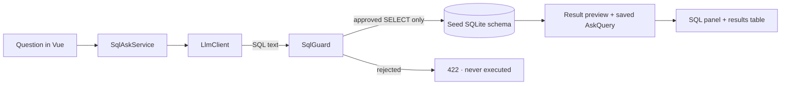

# SQL Ask Desk

**Ask a SQLite schema in English, inspect the SQL, and see guarded results.** SQL Ask Desk is a small Laravel 13 + Vue 3 demo that turns a natural-language question into a visible SQL query and runs it against a fictional Northwind Gadgets dataset.

## How it works



The model is behind `App\Services\Llm\LlmClient`. With no API key, the app binds `FakeLlmClient`, so the full experience works offline. Set `GEMINI_API_KEY` to use the optional Gemini client; provider calls have a 12-second timeout. Both implementations produce SQL text only—the app does not trust model output.

`SqlGuard` is the execution boundary. It accepts one `SELECT`, rejects comments, nested queries, mutating/admin keywords, and source tables outside `products`, `orders`, and `order_items`. Rejected SQL is saved with `status = rejected` and returned as HTTP 422 without being executed. Successful previews are capped at 100 rows. Provider or database errors are saved as `failed` and returned as HTTP 503 rather than an unhandled 500.

## Run locally without an API key

Requirements: PHP 8.4.1+, Composer, Node.js 20+, npm, and the PHP SQLite PDO extension.

```bash
composer install
cp .env.example .env
php artisan key:generate
php artisan migrate --seed
npm install
npm run dev
```

Open [http://localhost:8000](http://localhost:8000) in a second terminal after starting Laravel:

```bash
php artisan serve
```

Leave `GEMINI_API_KEY` blank. The app uses the local fake client; no account, API key, login, Redis, or external database is needed. The seed creates fictional products, orders, and order items for Northwind Gadgets. There are no demo credentials because the workspace is public and does not require authentication.

## Optional Gemini provider

Add the following to `.env` to use Gemini instead of the local fake:

```dotenv
GEMINI_API_KEY=your-google-ai-studio-key
GEMINI_MODEL=gemini-2.0-flash
```

The provider can return SQL, but cannot bypass the same guard used for fake responses. Keep secrets in `.env`; do not commit them.

## Tests

Run the focused suite:

```bash
php artisan test
```

The tests use SQLite in memory and fake LLM clients—no external API calls. They verify that a “top products” question is handled by the fake, a `SELECT` is saved and returns seeded rows, a generated `DROP TABLE` receives HTTP 422 without changing the table, unapproved tables are rejected, and provider failures are stored as `failed` with HTTP 503. Unit tests also exercise the SQL guard’s accepted join and rejected multi-statement, admin, comment, and unknown-table cases.

The starter kit's complete checks are available with:

```bash
composer test
npm run build
```

## Data model

- `products`: fictional catalog and inventory
- `orders`: fictional customer orders
- `order_items`: product quantities and prices per order
- `ask_queries`: question, generated SQL, row count, status (`ok`, `rejected`, or `failed`), and optional JSON result preview

Every question and outcome is stored for the recent-questions list. The demo executes only against the configured SQLite app database; do not point it at a production database.

## Stack

Laravel 13 · PHP 8.4 · Vue 3 · TypeScript · Inertia · Tailwind CSS · SQLite · Pest
